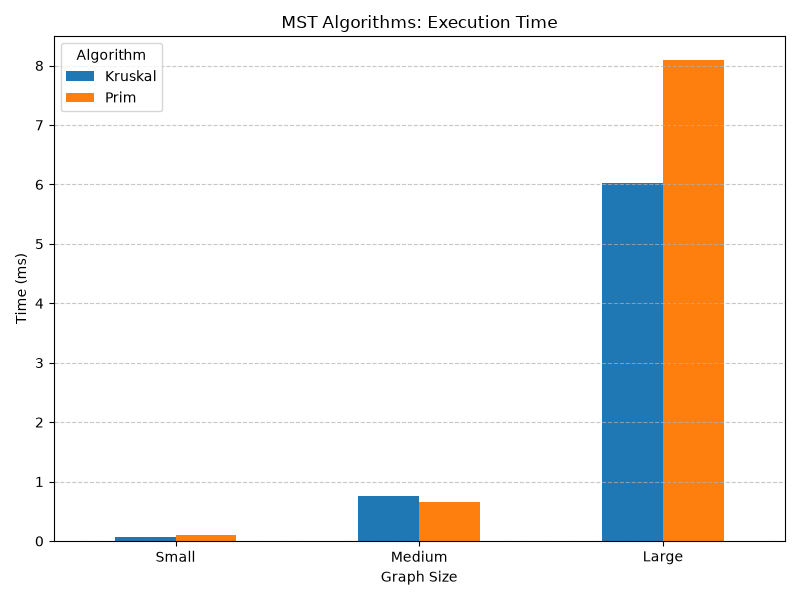
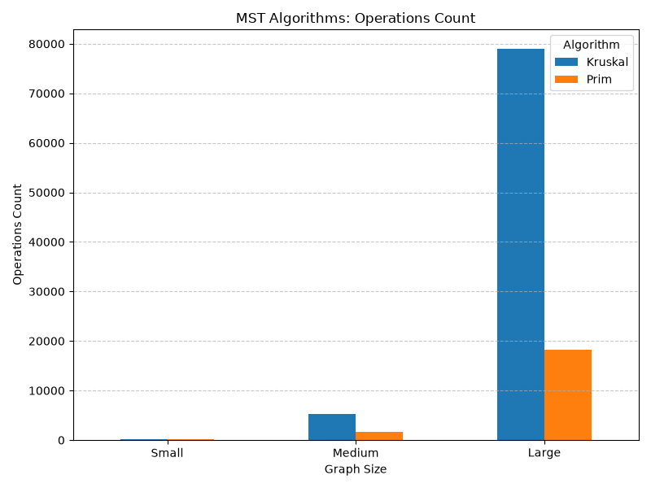
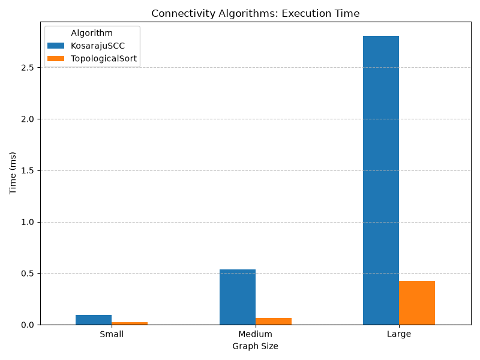
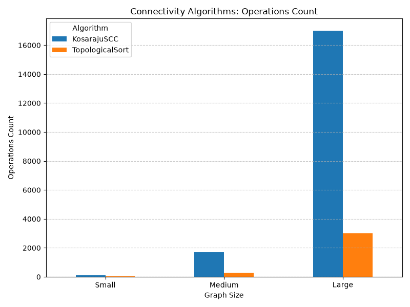
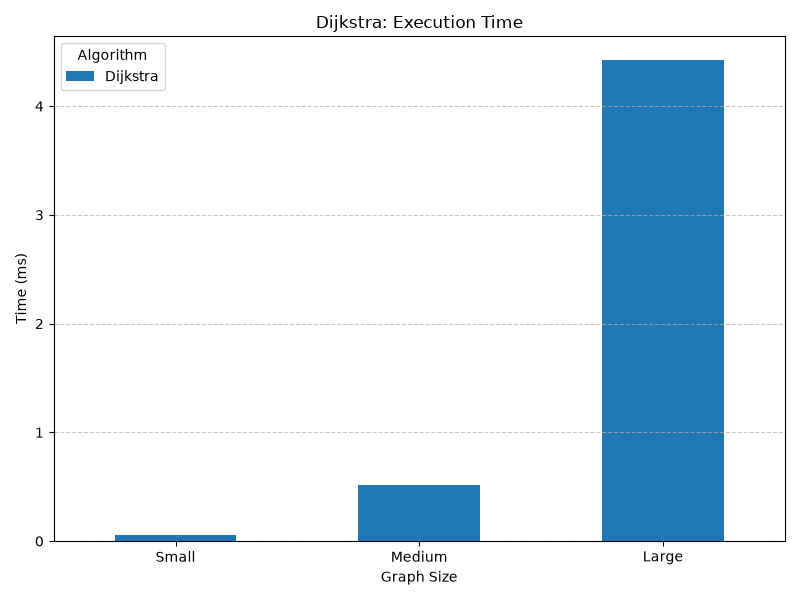
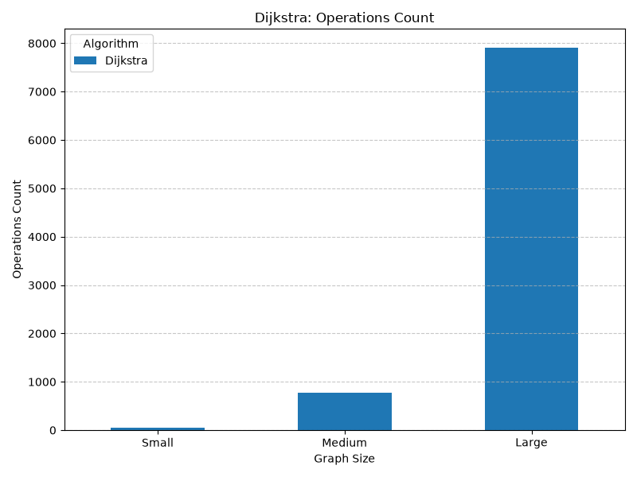

# DAA Assignment 3: Graph Algorithms & Performance Benchmarking

This repository contains the implementation and experimental analysis of fundamental graph algorithms, developed as part of the Design and Analysis of Algorithms (DAA) course.

## Project Structure
- `src/graph/` - Core graph representation (Adjacency List) and Edge classes.
- `src/dsu/` - Disjoint Set Union (Union-Find) data structure.
- `src/mst/` - Minimum Spanning Tree algorithms (Kruskal's, Prim's).
- `src/connectivity/` - Directed graph connectivity (Topological Sort, Kosaraju's SCC).
- `src/shortestpath/` - Shortest path algorithms (Dijkstra's).
- `results/` - Contains the generated CSV benchmark data and visualization plots.

## Implemented Algorithms

### 1. Minimum Spanning Tree (MST)
Implemented both **Kruskal's** (using DSU) and **Prim's** (using a Priority Queue) algorithms to find the MST in undirected graphs. Both algorithms effectively calculate the minimum weight required to connect all vertices and verify graph connectivity.

### 2. Connectivity in Directed Graphs
- **Topological Sort:** Implemented using Depth-First Search (DFS) to find a linear ordering of vertices in a Directed Acyclic Graph (DAG) and detect cycles.
- **Kosaraju's Algorithm:** Utilizes two passes of DFS (on the original and transposed graphs) to identify all Strongly Connected Components (SCCs).

### 3. Single-Source Shortest Path
- **Dijkstra's Algorithm:** Implemented using a Priority Queue to efficiently find the shortest paths from a source vertex to all other reachable vertices in a directed graph with non-negative edge weights.

## Experimental Analysis
Algorithms were benchmarked on three types of randomly generated graphs:
- **Small:** 10 Vertices, 30 Edges
- **Medium:** 100 Vertices, 500 Edges
- **Large:** 1000 Vertices, 5000 Edges

Each algorithm was executed 5 times per graph size, and the average execution time (ms) and operation counts were recorded.

### Performance Plots

#### Minimum Spanning Tree (Kruskal vs Prim)

#### Connectivity (Topological Sort vs Kosaraju's SCC)

#### Shortest Path (Dijkstra)

## How to Run
1. Run `Main.java` to execute the correctness tests and generate the `benchmark.csv` data.
2. Run `plot_benchmark.py` to process the CSV data and generate the performance charts.